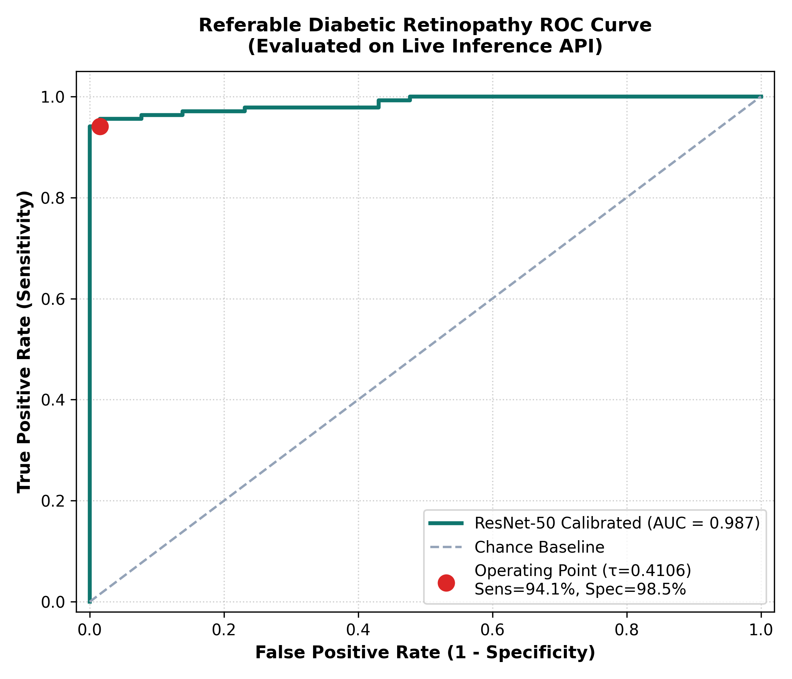
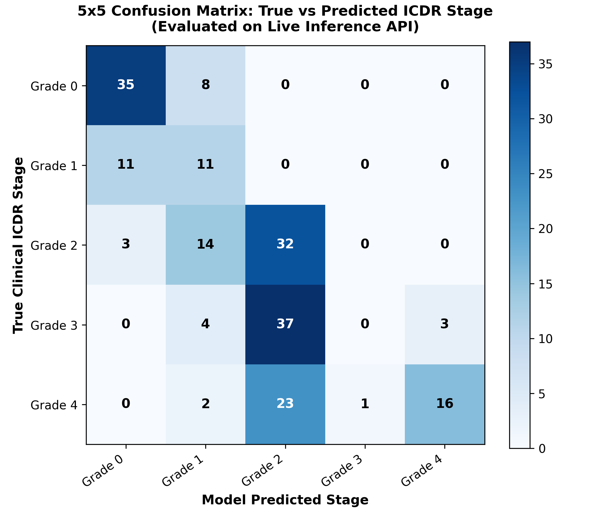
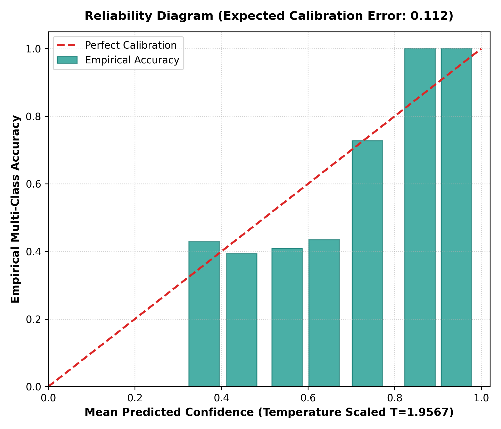

# RetinaScan Pro — Explainable Diabetic Retinopathy Screening Workstation

[](https://github.com/mjaiswaroop/Diabetic_Retinopathy/actions/workflows/ci.yml)

**RetinaScan Pro** is an offline-first, explainable AI (XAI) tele-ophthalmology workstation for **Diabetic Retinopathy (DR)** screening and triage. It combines a calibrated PyTorch ResNet-50 inference engine with live **Grad-CAM++** spatial saliency maps, optical quality gating, and a clinical Next.js workstation supporting bilateral (OS/OD) evaluation, PDF clinical reporting, Excel export, and encrypted local backup/restore.

> **Investigational Research Prototype Disclaimer:** This software is an academic and clinical-research decision-support prototype. It is **not** certified as a standalone medical diagnostic device under US FDA, EU MDR, or CDSCO regulations. All screening outputs must be reviewed and validated by a registered ophthalmologist.

---

## Key Features

- **Calibrated Deep Learning Pipeline (`backend/direct_server.py`)**:
  - ResNet-50 backbone (`384×384` FOV-cropped input) with 5-fold cross-validated temperature scaling (**$T = 1.9567$**) and sensitivity-calibrated referable cutoff (**$\tau = 41.06\%$** on $P(\text{Grade} \ge 2)$).
  - Live **Grad-CAM++** saliency overlays computed from `layer4.2.conv3`.
- **Single-Source-of-Truth Preprocessing & Fail-Safe Quality Gate (`ml/dr_preprocessing.py`)**:
  - Aspect-ratio-invariant retinal foreground cropping (`crop_fov`) for wide black-bordered, letterboxed, and circular fundus captures.
  - Automatic `180°` inversion parity for `20D`/`28D` smartphone indirect ophthalmoscopy adapters (`lens_type="20d"`).
  - Strict `UNGRADABLE` fail-safe (`grade = -1`, `referable = null`) for pure-black, pure-white glare, or severe defocus blur (masked sharpness `< 14.0`) — never defaults ungradable scans to `0%` or `Non-Referable`.
- **Clinical Workstation UI (`frontend/`)**:
  - Guided 5-step screening flow (`Register → Left Eye → Right Eye → Analysis → Result`) with bilingual/multilingual support (`en`, `hi`, `kn`).
  - Synchronized fundus + Grad-CAM++ inspection viewer and worst-eye triage banner (`Referable DR`, `Non-Referable`, `Uncertain`, `Ungradable`).
  - **Clinical Exports**: Print-ready A4 Clinical PDF report (`lib/export/pdfGenerator.ts`), Excel-compatible UTF-8 BOM `.csv` export, and full IndexedDB `.json` backup & restore (`lib/export/dataExport.ts`).

---

## Benchmark Performance ($N = 200$ IDRiD Cohort)

Evaluated end-to-end against the live FastAPI endpoint (`http://127.0.0.1:8000/api/v1/predict-direct`). Full tables and false-negative breakdown are documented in [`docs/benchmarks/BENCHMARK_REPORT.md`](docs/benchmarks/BENCHMARK_REPORT.md).

| Metric | Target | Live API Result | Status |
| :--- | :--- | :--- | :--- |
| **Referable DR Sensitivity** | $\ge 85.0\%$ | **94.07%** (`127 / 135`) | PASS |
| **Referable DR Specificity** | $\ge 80.0\%$ | **98.46%** (`64 / 65`) | PASS |
| **ROC-AUC (Referable DR)** | $\ge 0.900$ | **0.9866** | PASS |
| **False Ungradable Rejection Rate** | $< 2.0\%$ | **0.00%** (`0 / 200`) | PASS |
| **Average CPU Latency** | $< 1500\text{ ms}$ | **696.0 ms** | PASS |

| ROC Curve | Confusion Matrix | Reliability Diagram |
| :---: | :---: | :---: |
|  |  |  |

---

## Project Structure

```text
├── backend/
│   ├── direct_server.py        # FastAPI + PyTorch calibrated ResNet-50 & Grad-CAM++ server (:8000)
│   └── requirements.txt        # Python backend dependencies
├── frontend/                   # Next.js 14 clinical workstation UI (:3005)
│   ├── app/[locale]/           # Operator hub, screening capture, result dossier, dashboard, audit
│   ├── components/             # Synchronized viewer, EyeResultCard, ClinicalReport, stepper
│   └── lib/export/             # Clinical PDF generator, Excel CSV export, JSON vault backup/restore
├── ml/
│   ├── dr_preprocessing.py     # Shared crop_fov & masked sharpness quality gate
│   ├── test_ci_safety.py       # Automated safety regression suite
│   ├── benchmark_external.py   # 200-image live API benchmark & figure generator
│   └── outputs/                # Saved model weights & calibration artifacts
├── docs/benchmarks/            # Benchmark report & 300 DPI diagnostic plots
├── .github/workflows/ci.yml    # GitHub Actions CI (frontend build + backend safety gate)
├── start.bat                   # Windows 1-click launcher (backend + frontend + browser)
└── start.ps1                   # PowerShell launcher
```

---

## Quick Start

### Option 1: Windows 1-Click Launcher
Double-click `start.bat` (or run `.\start.ps1` in PowerShell) from the repository root to start both servers and open **http://localhost:3005**.

### Option 2: Manual Setup

#### 1. Backend Inference Server (Port `8000`)
```bash
pip install -r backend/requirements.txt
pip install torch torchvision --index-url https://download.pytorch.org/whl/cpu
cd backend
python direct_server.py
```
- Health check: `http://127.0.0.1:8000/health`
- API docs: `http://127.0.0.1:8000/docs`

#### 2. Frontend Workstation (Port `3005`)
```bash
cd frontend
npm ci --legacy-peer-deps
npm run build
npm run start
```
*(For development hot-reloading, run `npm run dev` instead of `npm run build && npm run start`.)*

---

## Verification & CI Regression Gate

With the backend running on port `8000`:
```bash
python -m unittest ml/test_ci_safety.py
```
Frontend verification:
```bash
cd frontend
npx tsc --noEmit
npm run build
```
